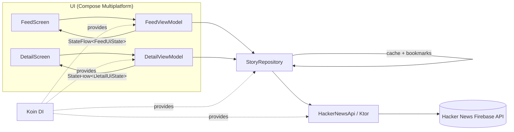

# KMP News — Kotlin Multiplatform Hacker News reader

A Hacker News client for **Android and iOS** with one shared codebase: networking, state and **100% of the UI** are written once in Kotlin with Compose Multiplatform.

[](https://github.com/trsimanto/kmp-news-reader/actions/workflows/build-android.yml)
[](https://github.com/trsimanto/kmp-news-reader/actions/workflows/build-ios.yml)

## Features

- **Top / New / Best / Saved** tabs
- **Pull-to-refresh** with loading, empty and error states (with retry)
- **Story detail** with score, author, domain and the top comments
- **Open article** in the system browser
- **Bookmarks** shared across screens through a single `StateFlow`
- **Dark mode** following the system setting
- **Shared UI**: the same Compose Multiplatform screens run on Android and iOS

## Tech stack

| Area | Library |
|---|---|
| Language | Kotlin Multiplatform (Android, iosArm64, iosSimulatorArm64) |
| UI | Compose Multiplatform, Material 3, Navigation Compose (type-safe routes) |
| State | AndroidX Lifecycle ViewModel (multiplatform), `StateFlow`, MVI-style UI state |
| Networking | Ktor client (OkHttp on Android, Darwin on iOS), kotlinx.serialization |
| DI | Koin |
| Concurrency | Kotlin coroutines (parallel item fetching with `async`/`awaitAll`) |
| Testing | kotlin.test, kotlinx-coroutines-test, Ktor `MockEngine` |
| CI | GitHub Actions (Android build, iOS tests + Xcode build) |

## Architecture



- **Screens** only render state and send intents (`selectTab`, `refresh`, `toggleBookmark`).
- **ViewModels** combine the screen state with the repository's bookmark stream into one immutable UI state.
- **StoryRepository** is the single source of truth: it fetches items in parallel, caches them in memory and owns bookmarks.
- **HackerNewsApi** is an interface, so the repository is tested with a fake and the Ktor implementation with `MockEngine`.

## Project structure

```
kmp-news-reader/
├── androidApp/                 # Android entry point (Activity + Application)
├── iosApp/                     # Xcode project, SwiftUI host for the shared UI
└── shared/
    └── src/
        ├── commonMain/kotlin/dev/towhid/newsreader/
        │   ├── data/           # HnItem/Story models, HackerNewsApi, StoryRepository
        │   ├── di/             # Koin modules
        │   ├── ui/feed/        # FeedScreen + FeedViewModel
        │   ├── ui/detail/      # DetailScreen + DetailViewModel
        │   ├── ui/components/  # StoryCard, loading/message views
        │   ├── util/           # timeAgo, HTML to text
        │   └── App.kt          # theme + navigation
        ├── commonTest/         # unit tests
        └── iosMain/            # MainViewController for iOS
```

## Running

**Android:** open the project in Android Studio and run the `androidApp` configuration, or:

```bash
./gradlew :androidApp:installDebug
```

**iOS:** open `iosApp/iosApp.xcodeproj` in Xcode and run on a simulator or device. Set your Team ID in `iosApp/Configuration/Config.xcconfig` to run on a physical device.

## Testing

```bash
./gradlew :shared:allTests
```

Covered: repository mapping and filtering, page size, caching, bookmarks, comment filtering, API paths and JSON parsing (`MockEngine`), relative time formatting and HTML-to-text conversion.

## Roadmap

- Persist bookmarks with SQLDelight or Room KMP
- Offline cache for the last loaded feed
- Nested comment threads
- Search via the Algolia HN API

## Acknowledgements

Bootstrapped from JetBrains' [Kotlin/KMP-App-Template](https://github.com/Kotlin/KMP-App-Template) (Apache 2.0). Data from the public [Hacker News API](https://github.com/HackerNews/API).

## Author

**Towhidur Rahman** — Lead Mobile Developer · [linkedin.com/in/trsimanto](https://linkedin.com/in/trsimanto)
